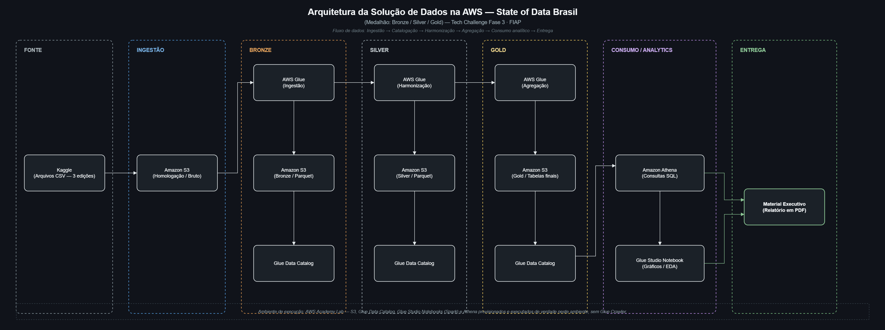

# State of Data Brasil — Pipeline AWS (Bronze/Silver/Gold)

Pipeline de dados e analytics na AWS (Glue Studio + Athena), construído para
entender o mercado brasileiro de Dados e Inteligência Artificial a partir de
3 edições da pesquisa **State of Data Brasil** (comunidade Data Hackers),
com um relatório executivo trazendo os principais achados e recomendações
estratégicas para uma instituição que quer expandir sua área de dados.

## 1. Identificação

| Campo | Valor |
|---|---|
| Curso | Pós-Tech — Data Analytics (FIAP) |
| Fase | Tech Challenge — Fase 3 |
| Autor | Gustavo Scalambrini |
| Equipe | Thales ([@thalesomie](https://github.com/thalesomie)) |

## 2. Objetivo

Construir uma solução completa de Big Data & Analytics na AWS — da ingestão
dos dados brutos até um relatório executivo com recomendações de negócio —
para responder, com dados reais, como está o mercado brasileiro de Dados e
IA: quem são os profissionais, quanto ganham, quais tecnologias dominam e o
quanto a IA já está (ou não) incorporada ao dia a dia das empresas.

## 3. Perguntas de Negócio

1. Como está estruturado o mercado de dados no Brasil (cargos, senioridade, região)?
2. Quais perfis profissionais são mais valorizados (remuneração)?
3. Qual o cenário de diversidade de gênero na área?
4. Quais tecnologias e linguagens estão em alta?
5. Qual o nível de adoção de Inteligência Artificial, individual e nas empresas?
6. Como região e modelo de trabalho influenciam a remuneração?
7. Quais as principais oportunidades e desafios do setor?

## 4. Fonte dos Dados

| Campo | Valor |
|---|---|
| Fonte | Pesquisa **State of Data Brasil**, da comunidade Data Hackers — publicada no Kaggle |
| Edições usadas | 2023-2024, 2024-2025, 2025-2026 (3 arquivos CSV, 1 por edição) |
| Volume | 13.057 respondentes após harmonização das 3 edições |
| Desafio principal | Cada edição usa um **schema de colunas diferente** — nomes, posição e até a codificação de valores booleanos mudam a cada ano |

A camada Silver mapeia ~28 campos-chave (demografia, cargo, senioridade,
salário, região, modelo de trabalho, tecnologias, uso de IA) das 3 edições
para um schema único. Detalhes do mapeamento estão em `docs/_headers_*.txt`
e `docs/_diagnostico_categorias.txt`.

## 5. Arquitetura da Solução (AWS)



```
Kaggle (3 edições, download manual)
  -> S3 (raw, os 3 CSVs)
  -> Glue Studio Notebook (Spark) -- lê os CSVs por caminho exato, SEM Crawler
       -> S3 Bronze (3 tabelas, 1 por edição) -> Glue Data Catalog
  -> Glue Studio Notebook (Spark) -> S3 Silver (harmonizado, 2 tabelas) -> Glue Data Catalog
  -> Glue Studio Notebook (Spark) -> S3 Gold (7 tabelas por tema) -> Glue Data Catalog
  -> Amazon Athena (7 scripts SQL, 1 por pergunta de negócio) -> métricas para o relatório
  -> Glue Studio Notebook — EDA (Spark + matplotlib) -> 11 gráficos
  -> Relatório executivo (PDF)
```

**Por que sem Glue Crawler?** O PDF oficial do desafio pede "ETL/ELT e
catalogação das tabelas com o Glue Jobs" e cita o Glue Notebook nominalmente
— um Notebook que lê os CSVs e cataloga via `saveAsTable()` atende o
requisito sem precisar de um Crawler separado, e ainda resolve, no mesmo
código, a harmonização entre as 3 edições (algo que um Crawler sozinho não
faz).

Abrir o `.drawio` original (editável) em [app.diagrams.net](https://app.diagrams.net/):
[`diagrams/arquitetura_solucao.drawio`](diagrams/arquitetura_solucao.drawio).

## 6. Evidências de que o pipeline rodou de verdade na AWS

Os notebooks deste repositório não são só código pronto para rodar — eles
foram executados, célula a célula, dentro do **AWS Academy Learner Lab**
deste time, e geraram os recursos reais abaixo (confirmados no console):

| Recurso | Nome real |
|---|---|
| Bucket S3 | `tech-challenge-gt26` |
| Database (Glue Data Catalog) | `db_techchallenge_gt_fiap` |
| Tabelas Bronze | `tb_bronze_2023_2024`, `tb_bronze_2024_2025`, `tb_bronze_2025_2026` |
| Tabelas Silver | `tb_silver_respondentes`, `tb_silver_tecnologias_adocao` |
| Tabelas Gold | `gold_perfil_mercado`, `gold_remuneracao`, `gold_diversidade_genero`, `gold_tecnologias_adocao`, `gold_adocao_ia`, `gold_prioridade_ia_empresa`, `gold_modelo_trabalho` |

A configuração de sessão do Glue (`%glue_version`, `%worker_type`,
`%%configure {"--enable-glue-datacatalog": "true"}`) foi validada contra a
[documentação oficial da AWS](https://docs.aws.amazon.com/glue/latest/dg/interactive-sessions-magics.html),
e a IAM role usada é a `LabRole` padrão do AWS Academy Learner Lab.

## 7. Como Reproduzir

### 7.1 Protótipo local (pandas) — roda em qualquer máquina

```bash
python -m pip install pandas pyarrow matplotlib seaborn
python src/silver_harmonization.py   # gera data/silver/*.parquet
python src/gold_builder.py           # gera data/gold/*.parquet
python src/eda_charts_aws.py         # gera presentation/charts/*.png com os números reais (AWS/Athena)
```

### 7.2 Ambiente AWS real (o que foi de fato executado)

Rodando no **mesmo bucket e database** listados na Seção 6, o resultado é
idêntico ao já documentado. Em **outra conta AWS** (por exemplo, para
avaliação em um Lab diferente), 3 ajustes são necessários — nomes de bucket
S3 são globais, então `tech-challenge-gt26` não pode ser reaproveitado por
ninguém além desta conta:

1. Criar um bucket próprio e subir os 3 CSVs brutos (Seção 4) nele.
2. Ajustar as variáveis `BUCKET` e `DATABASE` na célula de configuração de
   cada notebook (`src/build_notebooks.py` é a fonte que gera os 4 `.ipynb`).
3. Em **AWS Glue Studio → ETL jobs → Create job → Jupyter Notebook → Upload
   and edit an existing notebook**, subir cada notebook na ordem
   `01_bronze → 02_silver → 03_gold → 04_eda`, com a IAM role `LabRole` (ou
   equivalente), e rodar todas as células. Depois, colar os 7 scripts de
   `05_analytics_athena/` no editor do Amazon Athena.

Esse upload é manual pela própria interface da AWS — não é um deploy
automático disparado pelo GitHub; é assim que o Glue Studio funciona.

### 7.3 Relatório executivo (.docx/.pdf)

```bash
cd presentation
python -m pip install python-docx
python build_relatorio.py   # gera material_executivo.docx

# PDF: abra o .docx no Word, atualize o Sumário (botão direito > Atualizar
# campo > Atualizar o índice inteiro) e "Salvar como > PDF".
```

## 8. Principais Resultados

| Achado | Evidência |
|---|---|
| Mercado concentrado em cargos de dados e no Sudeste | Analista de Dados é o cargo mais comum; 61% dos 13.057 respondentes estão no Sudeste |
| Engenharia de ML é o cargo mais bem pago entre os mais comuns | Engenheiro de ML/AI Engineer com ~R$ 16,4 mil/mês em média |
| Mulheres são minoria e perdem espaço com a senioridade | 23,9% dos profissionais são mulheres; participação cai de 28,2% (júnior) para 20,1% (especialista/staff+); gap salarial de ~15% no nível sênior |
| Python ultrapassou SQL como linguagem mais usada | Share de Python sobe de 49% para 55% entre 2024 e 2025, enquanto o de SQL cai de 55% para 50% |
| Adoção individual de IA quase dobrou, mas a liderança não acompanhou | Uso pessoal de IA sobe de 80% (2024) para 98% (2025); só 23,8% dos gestores tratam IA Generativa como prioridade executiva |
| Região e modelo de trabalho pesam no salário mais do que se esperaria | Sudeste paga 36% a mais que o Nordeste; modelo híbrido flexível paga mais que 100% presencial |

Recomendações estratégicas completas (formalizar estratégia de IA, equidade
de gênero, trabalho remoto para acessar talento fora do Sudeste, e
capacitação em Python/Engenharia de Dados-ML) estão no relatório executivo.

## 9. Estrutura do Repositório

```
notebooks/
  01_bronze/ .. 04_eda/       Notebooks PySpark executados no AWS Glue Studio
  05_analytics_athena/        7 scripts SQL (1 por pergunta de negócio)
src/
  build_notebooks.py          Gera os 4 .ipynb — fonte da verdade do código PySpark
  silver_harmonization.py     Protótipo local (pandas) da harmonização
  gold_builder.py              Protótipo local (pandas) das tabelas Gold
  eda_charts_aws.py            Gera os 11 gráficos finais a partir dos números reais (Athena)
diagrams/
  arquitetura_solucao.drawio  Diagrama editável da arquitetura (Draw.io)
  arquitetura_solucao.png     Exportado do .drawio, embutido no relatório
presentation/
  material_executivo.pdf       Relatório executivo (entrega oficial)
  build_relatorio.py           Script que gera o relatório (.docx) a partir dos dados reais
  charts/                       Os 11 gráficos finais (PNG)
```

## 10. Links da Entrega

| Item | Link |
|---|---|
| Repositório | https://github.com/Gscalambrini/state-of-data-brasil-aws-pipeline |
| Relatório executivo (PDF) | [`presentation/material_executivo.pdf`](presentation/material_executivo.pdf) |
| Diagrama da arquitetura | [`diagrams/arquitetura_solucao.drawio`](diagrams/arquitetura_solucao.drawio) |

## 11. Tecnologias

- Python / PySpark
- AWS Glue Studio Notebooks (ETL + catalogação)
- Amazon S3 (data lake — Bronze/Silver/Gold)
- AWS Glue Data Catalog
- Amazon Athena (SQL analítico)
- Pandas, Matplotlib, Seaborn (protótipo local e geração de gráficos)
- python-docx (geração do relatório executivo)
- Draw.io (diagrama de arquitetura)

## 12. Autoria

**Gustavo Scalambrini** — pipeline de dados, análise e relatório executivo

- GitHub: [@Gscalambrini](https://github.com/Gscalambrini)
- LinkedIn: [gustavo-scalambrini](https://www.linkedin.com/in/gustavo-scalambrini)

**Thales** ([@thalesomie](https://github.com/thalesomie)) — co-autoria da
arquitetura da solução e validação do pipeline na AWS
